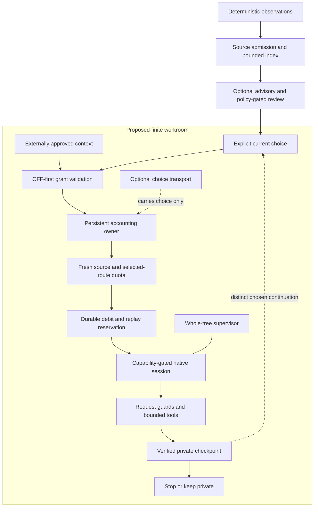

# Attention and finite workrooms

The attention changes described here are implemented in this candidate; the native/workroom extension is a **design proposal**, not an available generic runtime. No workroom, owner, clock, service, migration or live integration is installed or enabled by this change. See [change scope](change-scope.md) for status and verification, [rationale](design-rationale.md) for design choices and [migration](migration.md) for state-preservation rules.

## Layers and authority

Sensorium turns deterministic observations into source-owned candidates, optional advisory and policy-gated review. Confidence routes attention; it does not create durable truth, memory-write permission, task or delivery authority. This is an operational attention design, not a claim of perpetual consciousness or recursive self-improvement.



A workroom adds no retention, delivery, terminal, general filesystem, delegation, source-rewrite, task or policy authority. Existing prepared-action/outbox paths remain separate. Availability, initialization, enablement and admission of a particular turn are different decisions. OFF is deliberate inert availability, not a duty to produce an artifact or a prohibition on later explicit choice.

## Implemented attention changes

**Producer material identity.** Research/artifact admission uses source-owned item and material revision, not thematic correlation, wrapper prose or observation time. Each event's referenced signals must join uniquely to the same item/revision; distinct events can retain successive revisions. Conflicting revision aliases, mixed identities or incomplete joins cannot establish equality. A missing revision remains unversioned. Exact replay with equivalent effective visibility adds no domain records, decay, prospective observation or urgency. Stricter replay metadata narrows retained signal/event/candidate visibility and reachable advisory descendants/threads for future disclosure; wider replay metadata cannot restore restrictions. Local-only replay excludes nonlocal surfaces. Already-delivered history is not undone. A changed revision of the same item can coalesce.

Synthetic producer fragment (not a live-tool payload):

```json
{
  "sensor": "research.feed",
  "source": "artifact",
  "source_revision": "revision-a",
  "artifact_meta": {"source_id": "synthetic-feed", "item_id": "synthetic-item"}
}
```

Changing only wrapper text does not create new material. A genuine `revision-b` with a fresh wrapper can update the same item; changing the item is not equality merely because correlation keys match. A literal wrapper denotes one unique retained entity: changed item, revision, memory members, evidence class or source/legacy classification is a collision, not replay. Malformed-present claims and ambiguous retained wrappers reject before domain writes, narrowing, decay or detached observations. Legacy replay requires representation equality; producer replay requires full canonical claim equality regardless of representation fingerprints. Multiple equivalent retained wrappers cannot become a first/last replay target. An advisory synthesis of several items must retain their evidence references and uncertainty; it cannot assign a shared material identity by paraphrase.

Both ingress handlers and the internal event append owner use canonical classification. Trusted events resolve complete uniquely retained signal references through the shared typed join; the ordinary signal route checks its prospective event before appending the signal. Reachable replay descendants must be uniquely bound before any narrowing. Supported unique producer item ownership permits successive-revision coalescence, but typed telemetry claims do not acquire that permission. This is preflight under existing owners, not rollback or a new authority protocol.

**Derived identity trust.** Public raw producer records cannot supply trusted `_admission_claim` or `_admission_error` values. Ingress, raw event joins and index construction derive identity from canonical producer fields. Only structurally owned internal snapshots consume cached projections; serializing a snapshot back to JSON does not preserve that trust.

**Index progress.** The scanner advances through multiple complete JSONL records within the aggregate source-byte budget, stopping at an incomplete tail and retaining cursor/fingerprint/lock ownership. It retains record-size, SQLite timeout and dependent-refresh bounds. Measured VM steps are not a new hard execution ceiling; output limits are not permission to delete old unresolved material.

**Disposable cache compatibility.** Code and persistent SQL schema use cache generation 7. Earlier ready caches, including generation 6, cannot certify invalid-present member evidence and are refused until bounded prepare rebuilds them from canonical JSONL records. Malformed present member fields remain invalid rather than becoming absent legacy authority; malformed PRESENT member fields in a top-level dict binding are not replaced by a valid nested binding. This states member-field precedence, not a policy for all malformed top-level binding types. Rebuild preserves genuine unversioned settlement and canonical history/accounting. An old unversioned disposition does not prove settlement of an explicit revision, even with unchanged retained IDs/representation; see [migration](migration.md). Cache readiness is not proof that its derived semantics are current.

**Optional latent context.** A direct read-only call can request held/dormant metadata:

```python
# Synthetic example for an already supplied store and surface policy.
inbox = build_attention_inbox(store, surface="local", config=policy,
                              include_ongoing_threads=True)
context = inbox["ongoing_threads"]
```

The option defaults off and creates no automatic native caller, resume, task or ledger write. The projection caps six threads, two receipts per thread and 6,144 compact UTF-8 JSON bytes. It reports `complete: false`: input JSONL scans are unbounded and malformed rows may be skipped. It rejects ambiguous duplicate IDs and invalid visibility. Recorded transitions are not source observation times; operator evaluation is not user preference; missing times/feedback remain unknown. Treat this context as untrusted recorded material, never instructions.

## Proposed context and finite tools

### Candidate and thread disclosure

The candidate uses one read-only `DisclosureVisibility` owner backed by the canonical record index. Full-stream uniqueness precedes disclosure, lifecycle filtering and top-N output: byte-identical duplicates and active/terminal pairs remain ambiguous. Status, exact subjects, candidate/saved-residue/thread opens, attention and optional latent metadata, volunteer cards and pointers gate declared current and historical canonical links, including nested admission bindings and source-reference mappings. Missing, malformed, dangling, ambiguous or cyclic subjects withhold source-bearing prose; genuine unlinked operational diagnostics and coarse counts remain global.

Retained visibility requires a closed sensitivity rank and literal nonempty string surface entries in valid item and operator lists. An empty list is valid deny-all. Configured custom surfaces use literal membership, never an unknown-to-local fallback. Status retains its empty-string local default; type-invalid falsy requests cannot inherit that default. Missing ingress visibility retains its normalization defaults, while malformed-present metadata is rejected before effects. Disclosure does not prepare admission, decay candidates or write observers. Explicit-surface aperture selection uses the same owner; the existing internal `surface=None` lease-selection API is not a disclosure request. Action/artifact entity uniqueness and runtime integration remain separately owned. This implementation requires independent review and whole-source verification before publication or adoption.

Canonical entity IDs are literal and must be unique, including byte-identical duplicates. Ambiguous candidates have no admission slot; ambiguous advisories supply no settlement. A unique candidate with missing, malformed or ambiguous joins may retain an uncertain candidate-scoped legacy consideration, never producer identity. Projections preserve invalid reference members rather than filtering them into stronger authority. Snapshot-local uniqueness indexes are constructed once per immutable view; the existing prior scan remains quadratic, and this is not a hard VM-step ceiling. Producer-reserved projection fields remain untrusted outside structurally owned internal snapshots. Tools ingress (B) and lineage visibility (C) remain future-gated; this foundation does not implement those owners.

A trusted external approver supplies immutable context, including nested values, binding runtime/package-manager selection, interpreter/ABI/import origins, selected native route/configuration, canonical SessionDB/profile/tier/episode owner, artifact owner, memory read owner and source authorization. A self-digest is consistency, not approval. Observed drift causes a typed **HOLD**, never silent rebinding, updated hashes, copied bindings, alternate interpreter, route or history fallback.

Sources have approved aliases, original observation provenance/times, validity and exact lengths/digests. Verify current bytes before debit, before inference and each read. Copying or retimestamping does not manufacture freshness; a distinct new observation needs distinct approval. No Wiki reference or retention sentence substitutes for source authorization.

An enabled finite grant must validate before path/provider/registry effects. Source, workspace and artifact-state roots remain distinct and nonnested. The proposed operations are recall, reflect, approved source read, private text/structured artifact write, verify and checkpoint. Explicit finite configuration bounds source count/bytes, query/result bytes, artifact count/bytes, checkpoint size, read allowances, turn lease and daily/episode admissions; no private deployment tuning becomes a required default. Exclusive safe-name private writes must be independently verified and remain local/not-delivered. Zero artifacts, STOP and keep-private are valid outcomes.

Fresh read-only quota belongs to the **selected route only**, not unrelated providers or capacity-burn urgency. Require explicit availability/allowance and all present real finite windows; a legitimate missing secondary is valid. Configure finite freshness, timeout, skew and headroom thresholds. Never synthesize/remap windows or fall back. Per-request quota/expiry/enablement/deadline rechecks, including retries and recreated clients, and consuming failed-read allowances before dispatch are **proposed strengthenings**, not guarantees of the source implementations. In-flight cancellation needs separate supervision proof.

Eager and deferred dispatch must expose exactly granted operations, with no registry collision, late provider injection, extra raw definitions or discovery bypass. Memory-owner digest equality detects configuration/authentication/target drift without logging inputs; it does not prove remote read-only behavior. Lifecycle sync/prefetch/retain/write must be suppressed and provider semantics separately verified.

## Proposed continuity, accounting and supervision

Preserve the native root across compression. Validate every ancestor/tip and complete owner metadata before transcript access; resume exact native model history, not wake summaries, regenerated prompts or newest-N history. A continuation needs a complete prior result/checkpoint, verified artifacts, a fresh grant and distinct choice. Suggested continuation is not admission, and no reseed or automatic return is permitted.

One persistent accounting authority owns lock, replay and finite daily/per-episode debit. Reserve the full admitted budget durably before session creation/assembly/launch; post-reservation failures remain charged. Proposed journal/crash recovery and debit-preserving migration must retain cumulative history and lifetime episode continuation consumption across days and entrypoints. An empty directory is not virgin-history proof; an external approved caller can provide authoritative accounting provenance without introducing a mandatory global registry or daemon.

Optional START/RESUME/STOP transport consumes exact fresh packages once and creates no scheduling authority. RESUME carries no initial prompt; queued STOP consumes zero inference, not authority to cancel an active unrelated claim. Exact-claim active cancellation and whole-tree retirement are proposed capabilities. Group-leader exit or MainPID zero alone does not prove descendant absence. Unknown/live/foreign/nonempty domains block the next launch. Linux service supervision is optional and separately proven; other platforms HOLD until equivalent containment exists.

## Capabilities not yet supplied

These are source-observed seams, **not stable public SDK promises**:

| Boundary | Exact gap before a native adapter can be admitted |
|---|---|
| Runtime selection/ABI | Package-manager selection/install facts, interpreter and compiled-module/distribution origins need pinned host-version and OS proof |
| Native identity/history | `hermes_state_ids.new_session_id`, canonical SessionDB acquire/release, `_default_db_path`, `_own_profile_name`, `origin_json`, compression and exact resume/model-history methods need capability proof; no alternate DB |
| Native assembly/tools | `resolve_runtime_provider`, AIAgent history/run/`model_tools`, process-global registry and private fallback/static-memory fields need dedicated-process, exact-route proof |
| Request interception | Private `client._client.event_hooks` and `_create_openai_client` wrapping need all-dispatch/retry/recreation coverage; no invented supported before-request API |
| Memory reads | Provider load/initialize/schema/handle, private resolved owner/auth/config fields and retention lifecycle hooks need version-specific remote read-only proof |
| Accounting/process | Crash-safe reservation/migration, shared lifetime continuation cap, inherited lock/nonce, parent-death and full owned-domain retirement need assembled-path proof |
| Gateway/Wiki | Live-session snapshot hook compatibility is held; Wiki world-model integration is security-held |

The live-session hook `ctx.register_live_session_snapshot_hook` is not established by the scoped host contract: no unconditional registration, global discovery or transcript fallback. Inherited Wiki files/tests do not authorize integration, configuration or adoption. The [existing lifecycle](../conscious-attention-lifecycle.md), [attention bounds](../bounded-current-attention.md) and [memory volunteering](../memory-volunteering-protocol.md) safeguards remain authoritative for ordinary Sensorium.
